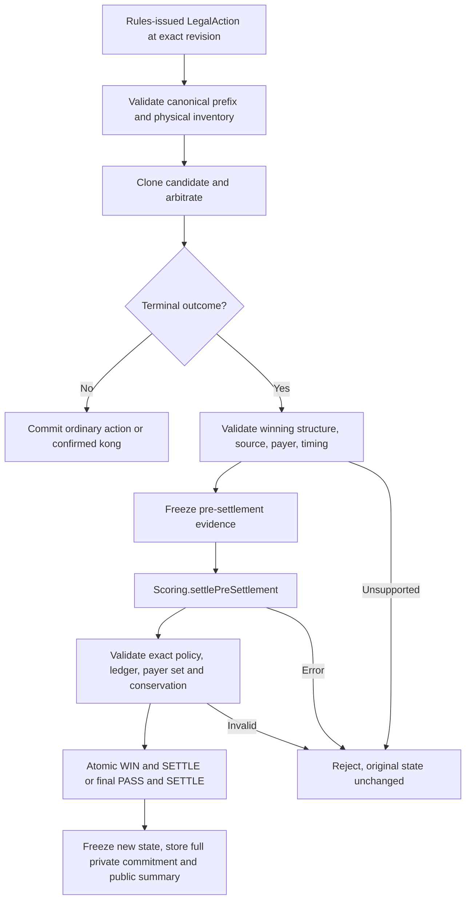

# R7.3 authoritative Rules settlement lifecycle

**EXPERIMENTAL / not a certified regional ruleset / not enabled in UI.**
Shared contract agreed with Scoring #52 in [acknowledgment](https://github.com/kodlbegiko/taiwan-mahjong-trainer/pull/51#issuecomment-7122101116). Agent 5 receives the same contract; Replay archive integration is a separate gate. No Scoring, Replay, Bot, UI or PWA source ownership is changed by #51.

## Profile pairing (exact, immutable)

| RuleProfile | ScoringProfile / policy | Status |
|---|---|---|
| tw16-four-player-sandbox@experimental-move-v1 | unavailable | unchanged |
| tw16-configurable-table@experimental-full-v1 | tw16-minimal-tai-v1 | unchanged; legacy multiple winners unsupported |
| tw16-single-winner-interception@experimental-v1 | tw16-minimal-tai-v1 | unchanged R5 |
| tw16-rob-added-kong@experimental-v1 | tw16-minimal-tai-v1 | unchanged R7.1 |
| tw16-authoritative-scoring@experimental-v1 | tw16-gametower-authoritative@1.0.0-experimental | opt-in only; exact registered profile; abstract points, zero fees |

The pre-settlement contract is `tw16-pre-settlement/1.0.0`. Robbery source negotiation is `tw16-rob-added-kong-public/1.0.0`. New public settle projection includes the versioned settlement summary. The previous four-player profiles' events and scores are not migrated. `getRuleCapabilities(newRef).scoring` gives the exact policy, contract and scoringRef. Never map a new ref to an old scorer.

## Executable host API

```js
import * as Rules from '../../src/rules/index.js';
import * as Scoring from '../../src/scoring/index.js';
const settlementRuntime = Rules.createSettlementRuntime(Scoring);
const opts = {settlementRuntime};
const state = Rules.createGame({...Rules.AUTHORITATIVE_RULE_REF,
  gameId:'example', seed:'explicit-seed'}, opts);
// Submit only a Rules-issued LegalAction from the matching actor/revision.
const next = Rules.applyAction(state, submission, opts).state;
Rules.validateGameState(next, opts);
Rules.replayGame(next, opts);
Rules.createPlayerView(next, 0, next.revision, opts);
```

The trusted host binds the actual Scoring module, not a user-supplied callback/profile or an object from storage. Runtime is branded and nonserializable; the registered profile snapshot is detached and deep-frozen. Missing runtime, version, unsupported fee/liability or mismatched registered profile rejects. R7.3 does not import the post-settlement comparison adapter. On a standalone Rules branch there are no Scoring-owned files, so only the combined checkout enables the new runtime. All earlier API call signatures remain valid without options.

## State transition



There is no durable intermediate "settling" phase and no public WIN event before scoring succeeds. Final arbitration reply and its result are one action group. For self-draw, WIN+SETTLE are one group. For exhaustive draw, last private PASS+SETTLE are one group. For robbed added kong, exactly one WIN and two PASS; the original triplet remains, the proposed physical tile becomes a proposal-river entry, the declarer alone pays. Three PASSes commit the kong and allow tail replacement, without triggering scoring. Competing winners, no replacement tile, unverified special timing and invalid scoring reject without producing a settlement. Settlement identity is roundId (gameId + round index); settled state has no LegalActions; a stale action or duplicate win cannot settle again.

Canonical Rules replay re-executes the original LegalActions using the same pinned runtime, checks the entire atomic group and compares the full state, including private evidence/profile/ledger and public payload. Returned R7.3 snapshots are recursively frozen and privately runtime-branded for subsequent same-runtime actions. Untrusted/deserialized copies or different runtime must fully replay before applying or projecting; the internal replay token is module-private. Historical states are not frozen or reinterpreted by this change. This is deterministic integrity, not a cryptographic signature or an external money-transfer system.

## Private pre-settlement envelope: single shared schema

Use the [Scoring-owned exact JSON Schema](https://github.com/kodlbegiko/taiwan-mahjong-trainer/blob/aa2535499377f4e3fc625506f1150f493191b791/docs/scoring/pre-settlement.schema.json) and [contract](https://github.com/kodlbegiko/taiwan-mahjong-trainer/blob/aa2535499377f4e3fc625506f1150f493191b791/docs/scoring/R73_AUTHORITATIVE_CONTRACT.md). Do not create a parallel competing input schema.

Fields: contractVersion, ruleRef, scoringRef, publicEventContractVersion, gameId, roundId, sourceRevision, settlementId (=roundId), reason, winType, payerSeats, evidence, evidenceEventIds, winningTileId. All exact; ordered unique evidence refs terminate at sourceRevision. The source revision is the candidate prefix AFTER the last private claim response (or the existing legal self-draw prefix), BEFORE public WIN/SETTLE.

| Fact | Authority / current boundary |
|---|---|
| winner/source/dealer | Rules-issued WIN, verified shape, complete claim window, round dealer |
| discard/robbery payer | sole source seat, validated physical river/proposal and three replies |
| self-draw payer | all three other seats; exact latest owned physical draw |
| prevailing wind | existing round wind enum mapped 27–30 |
| seat wind | absent; opening/dice alignment not modeled; applicable scoring rejects |
| dealer streak | exactly zero on genesis; non-genesis create/next-hand explicitly unsupported pending verified chronological continuation chain |
| hand / public meld / flower | immutable physical winner inventory, original meld/flower events and linked source |
| replacement / last live draw | private draw/flower provenance, immediately preceding committed concealed/added kong; open-kong variant rejects |
| initial orbit / special timing | initial deal or before all four seats discarded once rejects; conservative policy, not a Taiwan rule declaration |
| draw | reserveTail=16; actual final all-PASS window, no winner/payer, null evidence |
| special liability, multiple winners, flower-only wins | unsupported; no guessed rule |

## Raw terminal and public projection schema

WIN raw payload retains `{via,sourceSeat,winnerSeat,robAddedKong?}` (via remains 'discard' for robbery). The following public SETTLE has:
```js
{
 reason:'win', winnerSeat:2, tai:7, delta:[0,-7,7,0],
 scoringVersion:'tw16-gametower-authoritative@1.0.0-experimental',
 settlement:{ /* exact schema in r73-public-settlement.schema.json */ },
 robAddedKong:{proposalEventId:'evt:example:42',fromSeat:1,tileId:'t:5:2'}
}
```
The example values are illustrative; actual references and amounts come only from Rules/scorer.

Canonical private state: `extensions.tw16.result.authoritativeSettlement={evidence,ledger,publicEvidenceEventIds,scoringProfile}`. Full ledger includes the exact Scoring result (including full score/decomposition, evidenceEventIds, payments and conservation), and the registered frozen profile snapshot. `result.settlement` matches raw `settle.payload.settlement` and public projected `payload.settlement`. It contains only the safe score attribution (code/name/tai/ruleVersion/source/scope), payer/payee/points/handTai/appliedTai/dealerItems, delta/house/fee totals, public evidence IDs, version and result identity. It does NOT expose raw evidence IDs, private trigger IDs, evidence text or concealed decomposition. Full private ledger is deliberately NOT embedded in a public TurnEvent. The raw replay event records the safe public accounting result; replay recomputes and verifies the private commitment from the authoritative event sequence. New public summary is only emitted by the new RuleProfile. Preserve legacy public projection exactly. Unknown scoring version or malformed commitment rejects. This is the only Rules event-output schema for R7.3.

## Tests and integration gate

`RULES_REQUIRE_R73_SCORING=1 node --test tests/rules/r73-authoritative-settlement.test.js` on the combined exact checkout is mandatory. Standalone source can run its dependency guard; tests dependent on Scoring are explicitly skipped, not counted as integrated success. Source owners also run Scoring's strict combined gate and Replay's archive gate. Run `npm run check`, R5 100 fixed seeds and Legacy Seed87 strict expected rejection unchanged. R7.3 full settlement is not advertised to Bot/UI until all consumers negotiate the new profile, public settlement summary and runtime. Integrator must include `src/rules/settlement-lifecycle.js` and actual Scoring runtime imports in service worker graph and re-run offline integrity tests.

Historical R7.1 baseline `ff27c52526acfdf5fb905b4dd72a229289b8d734`: [Verify](https://github.com/kodlbegiko/taiwan-mahjong-trainer/actions/runs/45320766928), [Phase 3](https://github.com/kodlbegiko/taiwan-mahjong-trainer/actions/runs/45320766991), [Academy](https://github.com/kodlbegiko/taiwan-mahjong-trainer/actions/runs/45320766948) all SUCCESS. These cannot be reused as new HEAD CI.
